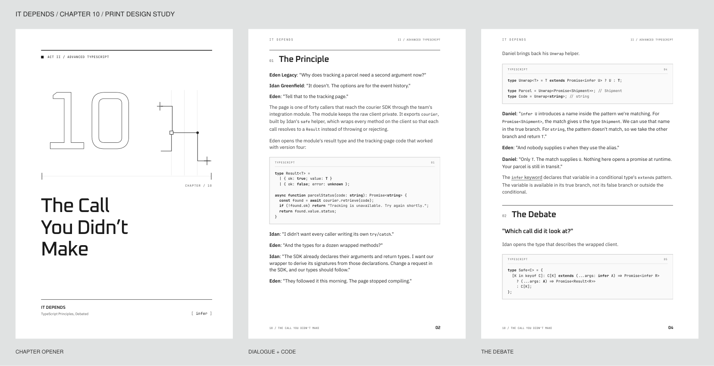

# Print design study

A minimal sci-fi direction for **It Depends — TypeScript Principles, Debated**.
The study renders the complete Chapter 10 in 6 × 9 and 7 × 10 inches. It reads
the manuscript directly; it does not maintain a second copy of the chapter.

**Working format: 7 × 10 inches.** The author approved the visual direction and
preferred this size after reviewing both samples. Keep 6 × 9 as a comparison.
The chapter opener is approved as a direction; final pagination still needs a
full-book pass.

Pagination should flow automatically with editorial constraints: headings stay
with a meaningful opening passage, short code examples stay together with their
introductions, and short dialogue turns stay together. Avoid isolated lines at
page boundaries. Review longer examples for sensible breaks and inspect every
spread once the manuscript is stable. The current template implements initial
keep-together rules; these do not replace that final review.

## Review the samples

These saved snapshots capture the September 24, 2026 design study:

- [7 × 10 PDF — working format](samples/chapter-10-7x10.pdf)
- [6 × 9 PDF — comparison](samples/chapter-10-6x9.pdf)



The build writes to `output/`; it does not replace these review snapshots.
Refresh the snapshots deliberately when a new design is approved.

## Direction

- **Oxanium** gives chapter openers and headings their angular character.
- **IBM Plex Sans** carries the dialogue and narration.
- **JetBrains Mono** carries the code and small navigation labels.
- Outlined chapter numbers, a restrained branching-line motif, and fine rules
  provide the visual identity. The reading pages stay mostly white.
- The interior is monochrome. Syntax remains legible without relying on color.
- Code is selectable text. Long lines wrap with a hanging indent; the source
  is unchanged. Example numbers are local to this design study.
- The chapter's linked sources are also listed with their URLs at the end so
  they remain accessible in a printed copy.

## Build

Python 3 and Google Chrome are needed. From the repository root:

```sh
python3 -m venv design/print/.venv
design/print/.venv/bin/pip install -r design/print/requirements.txt
design/print/.venv/bin/python design/print/build.py
```

On other platforms, pass `--chrome /path/to/chrome`. `--html-only` creates the
HTML without launching a browser. Rendering uses an isolated temporary Chrome
profile, bundled fonts, and local HTML. No manuscript is uploaded.

Generated PDFs, HTML, page images, and verification notes go in `output/`
(ignored by Git). Open `preview.html` after building. The HTML chapter files
are continuous screen previews; the PDFs are the authoritative paginated samples.
Browser versions can change pagination, so compare the rendered pages when
updating Chrome.

The build checks page dimensions, font embedding, all 20 code-block labels, and
the final dialogue. The page PNGs support visual inspection. These checks do not
replace checking pagination and readability by eye, or ordering a physical proof.

## Print assumptions

These are **design samples**, not the final publication files. They use supported
KDP trim sizes, single pages, embedded fonts, and no bleed. Page numbers start at
1 within the sample; front matter, final running heads, and book pagination still
need to be integrated. The inside margins are provisional: confirm the gutter
against the full book's page count and binding before submission. Cover dimensions
and spine design also wait for the final page count and paper choice.

KDP references:

- [Manuscript and cover file requirements](https://kdp.amazon.com/en_US/help/topic/G201857950)
- [Trim size, bleed, and margins](https://kdp.amazon.com/en_US/help/topic/GVBQ3CMEQW3W2VL6)
- [Printing cost and trim-size categories](https://kdp.amazon.com/en_US/help/topic/G201834340)

## Fonts

Bundled under the SIL Open Font License, with each license in `fonts/`:

- [Oxanium](https://github.com/sevmeyer/oxanium/tree/master/fonts/ttf)
- [IBM Plex Sans](https://github.com/IBM/plex/tree/master/packages/plex-sans/fonts/complete/ttf)
- [JetBrains Mono](https://github.com/JetBrains/JetBrainsMono)

The files were downloaded from those official repositories on September 24,
2026. Keeping the exact font files here makes subsequent renders independent of
changes to the upstream fonts.

## Settled page-bottom footnote trial

The Chapter 10 studies above remain unchanged. The separate step-1 trial reads
and hashes the frozen `book/` tree, derives its seven-link inventory, then renders
nine specimens: seven synthetic cases and two placements of all 17 actual book
tables, not a whole-book proof. Its current result is **PASS with table-header
repetition deferred**; see
[the trial review](../../docs/editorial/full-review/PRINT-TRIAL-REVIEW.md).
Do not use the study's source appendix as a fallback.

From the repository root, install only the pinned tools:

```sh
python3 -m venv design/print/.venv
design/print/.venv/bin/pip install -r design/print/requirements.txt
npm ci --prefix design/print --ignore-scripts
```

`trial-toolchain.json` pins the tested Node, Python, Chrome and Paged.js versions.
Chrome is the existing local application; the trial does not download a browser.
`package-lock.json` pins Paged.js's transitive dependencies. The Python tools
retain their existing exact requirements. No new Python packages are needed.

```sh
# Source/inventory, dialogue, metadata and marker controls only:
design/print/.venv/bin/python design/print/footnote_trial.py --validate-only

# Fresh trial (all nine specimens; table-header limitation reported explicitly):
design/print/.venv/bin/python design/print/footnote_trial.py

# Inspect saved artifacts again without running Chrome/pagination:
design/print/.venv/bin/python design/print/footnote_trial.py --inspect-existing

# Must reject the committed placeholders before rendering:
design/print/.venv/bin/python design/print/footnote_trial.py --mode release --validate-only
```

`release-metadata.json` is the only source of publication metadata. Proof mode
permits its placeholders and prints the README's `example.invalid` destination;
release mode rejects them. The fixtures always carry a proof footer. A passing
release metadata gate would not turn these synthetic pages into a release.

The inventory is parsed from Markdown inline tokens in the approved reading
order and compared with `link-inventory.json`. Speaker-labelled paragraphs,
quoted continuations, embedded quoted speech and blockquotes containing links
fail before rendering. Code literals do not count as links. This deliberately
conservative gate covers the book's dialogue syntax; it is not a classifier for
arbitrary prose. Keep any future exceptions editorial, not a silent bypass.

The local Chrome process uses a fresh temporary profile and file access for
Paged.js's local stylesheet loading. HTTP(S) document requests are blocked and
asserted absent. Font loading and the pagination promise must finish before PDF
capture; there is no fixed sleep standing in for completion. Timeouts fail the
run. Only the trial's browser/profile is cleaned up.

All generated HTML, rendered DOM, layout metrics, PDFs, extracted text, PNGs,
font/source hashes and `results.json` are under ignored
`output/footnote-trial/`. Every page has a PNG; `all-pages.png` is the contact
sheet. The verifier checks printed callout and note numbers as well as DOM
references: matching IDs alone missed the initial numbering failure. It also checks
full selectable URL text, clickable destinations, note placement, retained code
lines/table rows, embedded fonts and 7 × 10 trim. Every PDF page also asserts that
its callout numbers equal its note-body numbers; chapter reset restarts the
notes without restarting page numbers.

The authorized repair changes the note-marker counter to `footnote-marker`.
`chapter-counters.js` is a small local Paged.js Handler that preserves the folio
increment on a footnote-reset page; the pinned renderer otherwise disables that
increment. The whole-book build also carries the chapter note count across later
pages, so a first note several pages after its opener still starts at 1. There
are no new dependencies.

Every actual Markdown table is parsed from the frozen source, identified, hashed
and rendered twice: at a fresh-page placement and near a page boundary. Book
tables use `break-inside: avoid`; verification fails if a table has more than one
rendered fragment, exceeds the page body, or loses a cell in the DOM or PDF.
The largest is 436.77 pt in a 620.64 pt body. Repeating headers is therefore
deferred for this manuscript. The unchanged oversized synthetic table still
loses continuation headers; that becomes a recorded limitation only when both
complete sets of actual-table checks pass. No repeating-header handler is added.

`footnote-pages.png` collects the 14 pages of footnote cases, `book-tables.png`
collects the 17 natural-height table pages, and `all-pages.png` includes all 60
pages, including near-boundary placements. The initial failing artifacts are
preserved in `output/footnote-trial-before-b757e2e/`.

The trial itself does not assemble the book. Its success is not release approval.
The authorized whole-book proof follows below; it uses the same renderer and
page-bottom notes, with no manuscript rewrite or printer setup.


## Whole-book proof

Step 2 assembles the frozen **d03727a** manuscript through the approved 34-file
manifest. The current proof has **439 pages**, all marked **PROOF**, and passes
content, navigation and reproducibility checks. It still needs layout polish;
see the page-specific [spread review](../../docs/editorial/full-review/WHOLE-BOOK-PROOF-REVIEW.md).
This is not release approval.

Use the pinned environment installed for the trial, from the repository root:

```sh
# Each render requires its own absent output directory; archive prior runs first.
design/print/.venv/bin/python design/print/build_proof.py --run a
design/print/.venv/bin/python design/print/build_proof.py --run b
design/print/.venv/bin/python design/print/build_proof.py --compare

# Revalidate saved DOM/PDF artifacts and regenerate the final PDF/images:
design/print/.venv/bin/python design/print/build_proof.py --run a --inspect-existing
```

Outputs live in ignored `output/whole-book-proof-d03727a/`. The review PDF is
`a/It-Depends-PROOF.pdf`; `a/pages/page-001.png` through `page-439.png` are the
individual pages. `a/contact-sheets/spreads-01.png` through `spreads-28.png`
show consecutive facing pages. The independent `b/` render supplies comparison
evidence without duplicating the image gallery. Each run saves input hashes,
HTML, paginated DOM, layout metrics, extracted text, toolchain/font hashes and
`validation.json`; the pair produces `comparison.json`.

The proof uses continuous Arabic folios and starts each act/chapter on the next
page, without forced recto blanks. These are explicit proof settings, not final
pagination decisions. Generated contents and 191 hierarchical bookmarks use
measured destinations. All five fence languages are selectable, highlighted
text; continuation captions are generated, not inserted into the manuscript.
Assistant requests/transcripts have a distinct box style. All 17 book tables
must remain unsplit. Repeated table headers remain deferred as in the trial.

Validation covers the frozen source hashes, every rendered fence hash and source
text block, PDF text completeness, chapter note numbering, selectable URLs,
clickable callout and contents destinations, embedded fonts, trim, source bounds
and body/note separation. The pair comparison checks every page's text and
character geometry, link targets, bookmarks and raster hash; it also checks PDF
text bounds against trim. It excludes volatile PDF metadata/object IDs rather
than asserting raw file-byte identity. Layout observations such as sparse pages
and short code continuations are reported separately from lost/clipped content.

The source's final note stays before the final Verdict. The exact final narrative
line is asserted, and no generated appendix or notes follow it. The only page
furniture below it is the required proof footer and folio. Rendering remains
local with HTTP(S) requests blocked. Publication placeholders remain in the
single metadata file; the release metadata gate continues to reject them.


### Settled layout pass

The 428-page first proof remains in `output/whole-book-proof/` as comparison
evidence. The current commands write the revised proof to
`output/whole-book-proof-d03727a/`. Intermediate development renders stay there
under explicitly named `development-*` directories; `a/` and `b/` are the clean
comparison runs. Type sizes remain 11/16 pt for body text and 8.5/12.6 pt for
fences. No manuscript changes, added dependencies or renderer changes are used.

`ProofKeeps` adjusts Paged.js overflow boundaries backwards when CSS keeps would
strand a narrative heading, a short introduction or a fence fragment. Fences of
12 source lines or fewer stay whole; every fragment of a longer split has at
least four source lines. Saved-DOM checks assert the keeps and fragment counts.
Three measured tiny endings (Ch13, Ch20 and Ch21) receive earlier break choices;
the verifier counts their source lines separately from generated captions. Other
light ending pages are left alone. Unnumbered prologue and Bonus act openers no
longer get a numeral box; Bonus chapter numbers remain.

`prose_quotes.py` converts prose text tokens only. Code, literal URLs and link
labels containing code are protected. The actual printed delimiters are checked
for balance, and mapping curly punctuation back to straight must reconstruct each
source text block exactly, including whitespace. All 1,507 inline-code values
are checked unchanged in addition to the fence hashes. Five ambiguous paragraphs
are left unchanged and listed with source lines and proof folios in the review;
no guessed typography is applied to them.

The author replaced the proposed ligature removal with a print-only symbol key.
The code keeps its existing shaping. `symbol_key.py` joins the PDF character text
and glyph-drawing trace at their measured origins, restricted to source fences
and inline code. It compares glyph IDs with the bundled font cmap to inventory
actual fused combinations. Single-character contextual alternates and the blank
line placeholder are not multi-character ligatures. The key must cover exactly
that inventory: **26 sequences**, not the font's complete substitution list.
`symbol-key.json` holds the approved introduction and four ordered groups,
with a SHA-256 of the supplied text. The key uses body-size text on pages 5–6;
its 1,005-point natural height exceeds the 621-point page body. Breaks are allowed
only between whole groups. The intro's two inline examples must paint the fused
source glyphs. Paired meanings may share a cell; all 26 combinations retain
their own printed-glyph and typing cells. The key is generated after the contents, separately
from the manuscript manifest and text count. Its printed column must use glyphs
observed in the book; its typing column must use the individual character glyphs.
Both checks run against the saved PDF. Only that typing column isolates glyphs.

PR #40 is merged. The frozen source is main `d03727a0947a8434ac36e3978533152dc93a2e0f`,
with 34 files. Acknowledgments immediately follows the dedication as a single
quiet page, with its heading and three paragraphs, no opener or numeral box,
and an entry in contents and bookmarks. Manifest coverage is checked against
the frozen Git tree, not a hard-coded file count. Output directories derive
their suffix from the frozen commit; the 33-file layout checkpoint is preserved
in `output/whole-book-proof-layout/`. All new hashes and counts come from fresh
source parsing and rendering.
